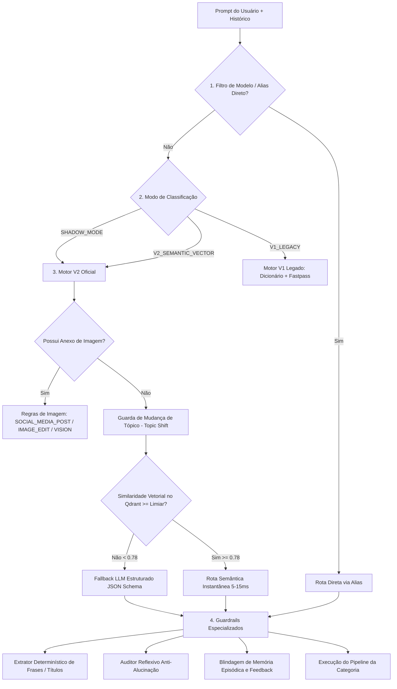

# Guia Completo: Filtro Semântico, Roteamento e Guardrails do Orquestrador

Este documento descreve detalhadamente a arquitetura de **interpretação de prompts, filtros em camadas e guardrails determinísticos** implementados no `langchain-orchestrator`.

---

## 1. Visão Geral da Arquitetura

O orquestrador atua como um **Proxy Inteligente com Classificação Semântica** entre a interface do usuário (LibreChat, APIs, automações) e os modelos de linguagem de ponta.

Para garantir **latência mínima**, **alta precisão de roteamento** e **eliminação de alucinações**, o sistema opera em uma esteira de decisão em cascata:



---

## 2. Detalhamento dos Filtros

### 2.1. Filtro de Modelo (Direct Model Alias & Priorização)

O **Filtro de Modelo** inspeciona o identificador do modelo solicitado no payload da requisição (`payload["model"]`). 

#### A. Roteamento Direto por Alias (Fast-Pass de IDE / Skills)
Quando o usuário seleciona um agente ou skill especializado no LibreChat ou via API, o orquestrador ignora o classificador semântico e despacha imediatamente para o pipeline especializado (latência de 0ms):

| Padrão no Nome do Modelo (`req_model`) | Categoria Atribuída | Routing Method |
| :--- | :--- | :--- |
| `agent-coding`, `opencode`, `coding-fast`, `coding-exec`, `coding-plan`, `skill-coding`, `skill-devops`, `skill-system-designer`, `skill-code-audit` | `CODING` | `direct_model_alias` |
| `agent-social`, `social-media`, `agent-marketing`, `social-post`, `skill-social-media`, `skill-social-smart` | `SOCIAL_MEDIA_POST` | `direct_model_alias` |
| `agent-data`, `data-export`, `export-excel`, `chart-generator`, `bi-chart` | `DATA_EXPORT_CHART` | `direct_model_alias` |

#### B. Priorização Dinâmica de Modelos por Categoria
Cada categoria possui uma cadeia de modelos com failover automático gerenciada em tempo de execução via [`admin_config_service.py`](file:///home/jean/langchain-orchestrator/admin_config_service.py):
- **Cadeia Padrão do Classificador (`SEMANTIC_CLASSIFIER`)**: `Classifier_Fast` (primário) $\rightarrow$ `Combo_Free_Chat` (fallback).
- **Cadeia do Pesquisador Social (`SOCIAL_RESEARCH`)**: `Coding_DeepSeek_V3` / `ComboFree_Smart` (padrão) e `Reasoning_DeepSeek_R1` (pedidos complexos).
- **Cadeia do Criador Social (`SOCIAL_CREATOR`)**: `ComboFree_Smart` $\rightarrow$ `Coding_DeepSeek_V3` $\rightarrow$ `Combo_Free_Chat`.

---

### 2.2. Filtro de Contexto (Context Filter & Continuidade Conversacional)

O **Filtro de Contexto** analisa o histórico de mensagens da sessão para determinar se a mensagem atual é uma instrução isolada ou uma continuação direta de um raciocínio anterior.

#### Parâmetros e Heurísticas
1. **Identificação de Dependência Contextual (`is_context_dependent_prompt`)**:
   - Detecta anáforas e pronomes demonstrativos: *"e no linux?"*, *"como resolvo isso?"*, *"refaça o anterior"*, *"substitua por esse"*, *"por que aconteceu aquilo?"*.
   - Avalia o comprimento do prompt: mensagens com menos de 4 palavras sem verbos imperativos fortes herdam o estado da sessão.
2. **Estado de Sessão (`get_conversation_state`)**:
   - Registra `last_category` (última categoria executada com sucesso) e `last_model`.
3. **Guardrail de Mudança de Tópico (*Topic Shift Guardrail*)**:
   - **Problema resolvido:** em sessões longas, se o usuário gerou um post de rede social e em seguida fez uma pergunta de infraestrutura (*"como configuro o samba no ubuntu?"*), classificadores ingênuos continuavam na categoria `SOCIAL_MEDIA_POST`.
   - **Mecanismo:** o motor V2 verifica se a categoria anterior era social e o prompt atual não possui nenhuma palavra-chave social. Se detectado, **desconecta sumariamente o histórico** e força uma nova classificação isolada.
4. **Reescritor de Perguntas Incompletas (*Query Rewriter*)**:
   - Quando o classificador LLM retorna o campo `rewritten_prompt` preenchido e com acréscimo semântico substancial, o orquestrador substitui a mensagem atual pela versão expandida, garantindo que os agentes posteriores (RAG, Pesquisa, Código) recebam o contexto pleno.
5. **Filtro de Anexos Multimodais**:
   - `message_has_image(last_user_msg)`: detecta blocos `image_url` e `data:image/` base64.
   - `history_has_images(messages)`: verifica se imagens foram enviadas em turnos anteriores para permitir reedição sem reenvio do arquivo.

---

### 2.3. Filtro Semântico (Semantic Vector Router - Motor V2)

O **Filtro Semântico Vetorial** é o núcleo do Motor V2, responsável por identificar a intenção com base na proximidade angular em um espaço vetorial denso.

#### Parâmetros Técnicos Definidos

| Parâmetro | Valor Configurado | Descrição |
| :--- | :--- | :--- |
| **Coleção Qdrant** | `semantic_routes_v2` | Coleção dedicada no banco vetorial Qdrant para roteamento. |
| **Dimensão dos Vetores** | `768` | Tamanho do embedding gerado pelo modelo `nomic-embed-text` / Ollama. |
| **Métrica de Distância** | `Cosine` | Similaridade cosseno entre o vetor do prompt e as sementes canônicas. |
| **Limiar Vetorial (`SEMANTIC_ROUTER_THRESHOLD`)** | **`0.78`** | Pontuação mínima de similaridade para aceitação direta do match vetorial. |
| **Latência Típica** | **5ms a 15ms** | Execução local em memória/Qdrant sem chamada de LLM externa. |

#### Funcionamento da Similaridade Vetorial:
1. O prompt do usuário é vetorizado em tempo real: $\vec{v} = \text{embed}(prompt)$.
2. O Qdrant executa busca de vizinhos mais próximos contra a coleção `semantic_routes_v2`:
   $$\text{score} = \frac{\vec{v} \cdot \vec{s}}{\|\vec{v}\| \|\vec{s}\|}$$
3. Se $\text{score} \ge 0.78$: a categoria associada à semente canônica mais próxima é adotada imediatamente com o método `v2_semantic_vector`.
4. Se $\text{score} < 0.78$: o sistema não arrisca uma falsa classificação e aciona o **Fallback LLM Estruturado via JSON Schema** (`classify_with_structured_json`).

#### As 20 Categorias Canônicas Suportadas
1. `CODING` (Desenvolvimento, scripts, APIs, docker, servidores, redes e SMB)
2. `SOCIAL_MEDIA_POST` (Posts, carrosséis, hooks, stories e marketing)
3. `IMAGE_GENERATION` (Geração de imagens do zero)
4. `IMAGE_EDIT` (Alteração de elementos, fundo ou estilo de imagens)
5. `SHORT_VIDEO` (Roteiros e parâmetros para vídeos verticais / Reels / TikTok)
6. `WEATHER_INFO` (Previsão do tempo e meteorologia)
7. `REALTIME_SEARCH` (Notícias em tempo real, cotações, esportes, CEP, CNPJ, FIPE)
8. `CASUAL_CHAT` (Saudações, agradecimentos, conversação livre)
9. `LOCAL_THINKING` (Raciocínio lógico simples, quebra-cabeças)
10. `HEAVY_REASONING` (Cálculo avançado, matemática formal, xadrez, física)
11. `FACTUAL_GENERAL` (História, geografia, ciências, literatura geral)
12. `VISION` (Descrição e transcrição direta de imagens anexadas)
13. `DATA_EXPORT_CHART` (Geração de tabelas para download em Excel/CSV e gráficos)
14. `MCP_FILESYSTEM` (Operações no workspace seguro local)
15. `MCP_FETCH` (Extração e leitura direta de páginas web por URL)
16. `MCP_GIT` (Controle de versão e comandos Git no workspace)
17. `MCP_BRAVE_SEARCH` (Busca web alternativa via protocolo MCP)
18. `MCP_DATABASE` (Consultas SQL analíticas e inspeção de banco SQLite/DuckDB)
19. `MCP_CODE_RUNNER` (Execução de código python/bash em sandbox isolada)
20. `DOCUMENT_RAG` (Busca e respostas baseadas em manuais e PDFs corporativos)

---

## 3. Modos de Roteamento Disponíveis

O sistema suporta três modos de operação configuráveis no painel administrativo ou via variável de ambiente:

### 3.1. Modo Sombra (`SHADOW_MODE`) — *Padrão de Produção*
- **Resposta Oficial:** O **Motor V2 (Vetorial + JSON Schema)** define a rota e executa o pedido do usuário com latência mínima.
- **Comparador em Segundo Plano:** O **Motor V1 (Dicionário + Regras + LLM livre)** é disparado de forma assíncrona (`asyncio.create_task`) com timeout de 5 segundos.
- **Auditoria A/B:** O sistema compara o veredito de V2 com V1 e grava no log de execução:
  ```text
  [SHADOW MODE COMPARISON] V2 (Oficial): CODING | V1 (Comparativo): CODING | Concordância: True
  ```
- **Vantagem:** Permite validar e calibrar continuamente a nova arquitetura vetorial em produção com risco zero de degradação da experiência do usuário.

### 3.2. Modo Semântico Vetorial Puro (`V2_SEMANTIC_VECTOR`)
- Executa exclusivamente o pipeline vetorial do Qdrant e o fallback estruturado JSON Schema.
- Não dispara tarefas de comparação em segundo plano, economizando ciclos de CPU e limites de taxa de chamadas (rate limits).

### 3.3. Modo Semântico e Dicionário / Motor Híbrido (`V1_LEGACY`)
- **Dicionário Universal de Termos ([`universal_dictionary.json`](file:///home/jean/langchain-orchestrator/data/universal_dictionary.json)):**
  - Mapeamento estático contendo mais de 500 termos, frases e verbos organizados por categoria.
  - Recarregamento a quente (*hot-reload*) automático em memória baseado no `mtime` do arquivo.
- **Fast-Pass Heurístico por Regex (0ms):**
  - Expressões regulares de alta precisão para termos críticos (ex.: `\d{2}\.\d{3}\.\d{3}/\d{4}-\d{2}` para CNPJ, padrões de CEP, tabela FIPE, comandos Linux/Samba).
- **Lexicon Pessoal do Usuário ([`user_lexicon_service.py`](file:///home/jean/langchain-orchestrator/user_lexicon_service.py)):**
  - Mecanismo de auto-aprendizado que memoriza jargões e termos específicos do usuário a partir das suas interações bem-sucedidas.

---

## 4. Guardrails e Filtros Determinísticos Especiais

### 4.1. Guardrail Determinístico de Frases ([`phrase_extractor_guardrail.py`](file:///home/jean/langchain-orchestrator/phrase_extractor_guardrail.py))

Projetado especificamente para impedir que agentes criativos de marketing inventem títulos ou ignorem textos obrigatórios solicitados pelo usuário.

#### Formatos de Entrada Reconhecidos Deterministicamente:
1. **Aspas:**
   - Duplas: `"Troféu Kim Mollo 2026"`
   - Simples: `'3º lugar - 100m borbo'`
   - Tipográficas: `“Destaque do Ano”`, `«Campeão Paulista»`
2. **Listas em Tópicos / Bullets:**
   - `- Frase 1` / `* Frase 2` / `• Frase 3`
   - `1. Título do post` / `2. Subtítulo`
3. **Campos Explícitos:**
   - `Título: Troféu Kim Mollo` | `Subtítulo: 3º lugar`
   - `Texto 1: X` | `Texto 2: Y`
4. **Gatilhos em Texto Corrido (sem aspas):**
   - Expressões: `inclua a frase...`, `coloque o texto...`, `com os dizeres...`, `insira na foto a frase...`
   - Exemplo: *"crie um post e inclua a frase Troféu Kim Mollo 2026 e o subtítulo 3º lugar"*
   - O extrator separa automaticamente o título e o subtítulo através de conectivos como ` e o subtítulo `, ` com rodapé `, etc.
5. **Inspeção Retroativa de Histórico:**
   - Em pedidos de reedição (*"refaça o post com as frases solicitadas"*), o extrator varre as mensagens anteriores do usuário em busca das frases exatas originais.
6. **Sanitização de Metatags:**
   - Remove defensivamente blocos injetados pelo sistema (`[DIRETRIZ DE APRENDIZADO]`, `[CONTEXTO & PREFERÊNCIAS]`) e palavras-chave estruturais (`**Provedor:**`, `**Modelo:**`).
7. **Filtro de Comandos Imperativos (`is_instruction_command`):**
   - Detecta e descarta instruções ao bot (ex.: *"faça uma montagem dos meus filhos"*, *"quero postar no instagram"*, *"crie um post"*, *"deixe só a foto"*), garantindo que comandos do usuário **nunca** sejam confundidos com frases de sobreposição tipográfica no post.
   - Se o usuário não especificou nenhuma frase para ser escrita, a composição visual é mantida 100% limpa (`headline = ""`), orientando o motor de imagem explicitamente a não desenhar letras ou textos.
8. **Filtro de Intenção Estruturada (`extract_phrase_intent`):**
   - Classifica a ação semântica em relação aos textos da arte:
     - `remove_all_text`: *"tire tudo que estiver escrito"*, *"deixe só a foto"*, *"sem texto"* (gera restauração limpa).
     - `replace_phrase`: *"substitua 'A' por 'B'"*, *"troque a frase 'A' por 'B'"* (substituição cirúrgica).
     - `remove_word`: *"remova apenas a palavra 'montagem'"* (remoção pontual de palavra).
     - `set_phrase`: *"altere a frase para: 'B'"* (alteração de frase mantendo a cena).
9. **Fallback via Guardrail Semântico (`Classifier_Fast`):**
   - Se o prompt contiver intenção de frase em formato livre mas não puder ser segmentado por regex pura, dispara uma extração JSON via LLM com temperatura `0.0`.

---

### 4.2. Continuidade do Modelo Criador e Vantagem Técnica em Edições (`IMAGE_EDIT`)

Localizado em [`image_service.py`](file:///home/jean/langchain-orchestrator/image_service.py), resolve o roteamento de alterações em imagens previamente geradas:

1. **Prioridade Absoluta ao Modelo Solicitado:**
   - Se o prompt do usuário cita explicitamente um modelo ou provedor (ex.: *"Utilize o modelo da OpenAI GPT-2.5-Sunburst"* ou *"Use o FLUX"*), o orquestrador detecta a preferência via `detect_requested_model_in_prompt()` e encaminha diretamente para o motor indicado.
2. **Preferência pelo Modelo Criador Original:**
   - Ao solicitar uma alteração de post ou arte existente, o orquestrador inspeciona o histórico de mensagens via `detect_image_context_from_history()`.
   - Se a imagem foi originalmente concebida pelo **OpenAI `gpt-image-2.5-sunburst`**, esse modelo é preferido para a edição subsequente, preservando estilo, iluminação e identidade dos sujeitos.
3. **Priorização por Vantagem Técnica (Tipografia & Texto em Português):**
   - O modelo **OpenAI (`gpt-image-2.5-sunburst`)** possui clara vantagem técnica sobre outros motores para renderização de caracteres acentuados, substituição de palavras e remoção cirúrgica de textos.
   - Portanto, em solicitações de ajuste de frase, substituição ou remoção textual, a OpenAI é automaticamente priorizada na esteira de edição.
4. **Restauração Instantânea de Foto Limpa:**
   - Quando o usuário pede *"tire tudo que estiver escrito / deixe só a foto"* em uma arte montada via Pillow (`composed_...`), o orquestrador recupera instantaneamente a fotografia original limpa do disco com latência mínima e zero degradação por IA.

---

### 4.3. Guardrail de Intenção Genérica

Localizado em [`social_service.py`](file:///home/jean/langchain-orchestrator/social_service.py), avalia pedidos excessivamente curtos ou vagos (ex.: *"faça um post para mim"* sem anexo nem menção ao tema).
- Em vez de gerar conteúdo alucinado ou genérico, o guardrail **bloqueia o pipeline** e responde orientando o usuário sobre como fornecer o tema e escolher entre os modos:
  - ⚡ **Modo Fast (Padrão):** Focado em velocidade e montagem direta de textos sobre foto anexada via Pillow.
  - 🧠 **Modo Smart:** Geração multimodal avançada via GPT Image e redação inteligente.

---

### 4.3. Guardrail de Feedback Negativo / Anti-Exemplos

Localizado em [`feedback_service.py`](file:///home/jean/langchain-orchestrator/feedback_service.py):
- Vetoriza respostas que receberam avaliação negativa (`thumbsDown`) no LibreChat e as armazena no Qdrant (`feedback_memory`).
- Quando uma nova pergunta tem similaridade $\ge \mathbf{0.82}$ com um caso reprovado, o orquestrador injeta uma diretriz corretiva proibindo os erros cometidos anteriormente.
- **Isolamento de Segurança:** Para evitar contaminação do texto do usuário, o guardrail é **desativado em rotas de mídia e design** (`SOCIAL_MEDIA_POST`, `IMAGE_GENERATION`, `IMAGE_EDIT`, `VISION`).

---

### 4.4. Auditor Reflexivo Anti-Alucinação (*Fact-Checking Guardrail*)

Localizado em [`prompts.py`](file:///home/jean/langchain-orchestrator/prompts.py) (`FACT_AUDITOR_PROMPT`):
- Audita a resposta preliminar contra fontes factuais (documentos da base ou dados de busca em tempo real).
- Se a resposta inventou dados ou contradisse fontes, o auditor altera o status para `CORRECTED` e entrega uma resposta devidamente retificada antes do envio ao usuário.

---

### 4.5. Memória Episódica Persistente e Perfil Comportamental

Localizado em [`episodic_memory_service.py`](file:///home/jean/langchain-orchestrator/episodic_memory_service.py):
- Extrai e persiste fatos declarados pelo usuário (ex.: nome, cargo, preferências de estilo).
- Consulta as memórias permanentes com limiar $\ge 0.55$ para personalizar respostas conversacionais.
- Assim como o guardrail de feedback, a memória corporativa episódica é estritamente isolada de rotas de criação visual para não injetar nomes de empresas não relacionadas nas legendas dos posts.

---

### 4.6. Conversor de Markdown para PDF Formatado (PDF_EXPORT)

Localizado em [`pdf_export_service.py`](file:///home/jean/langchain-orchestrator/pdf_export_service.py):
- Converte textos ricos em Markdown diretamente para documentos PDF no padrão A4 com diagramação editorial executiva (fontes modernas, tabelas zebradas, blocos de citação com bordas acentuadas, cabeçalhos correndo e paginação `Página X de Y`).
- **Guardrail Anti-DOCUMENT_RAG**: Impede que pedidos de exportação de PDF (ex.: *"Gere um PDF desse resumo"*, *"Converta o texto anterior em PDF"*) caiam na busca de documentos internos existentes (`DOCUMENT_RAG`) ou no terminal de arquivos (`MCP_FILESYSTEM`).
- **Modos de Operação**:
  1. *Follow-up conversacional*: O usuário pede um resumo ou análise e, em seguida, solicita a exportação em PDF. O orquestrador recupera o Markdown da última resposta do assistente e gera o arquivo instantaneamente.
  2. *Anexo direto no prompt*: Quando o prompt solicita tanto a geração do conteúdo quanto o PDF (ex.: *"Faça um resumo sobre X e anexe em PDF"*), o pipeline gera a resposta e anexa o card de download ao final.
  3. *LibreChat Action / Skill*: Endpoint publicado em `/v1/skills/export/markdown-to-pdf` compatível com especificações OpenAPI 3.1.

---

## 5. Resumo dos Limiares e Constantes do Sistema

| Componente | Parâmetro | Valor | Arquivo de Origem |
| :--- | :--- | :--- | :--- |
| **Roteador Semântico V2** | `SEMANTIC_ROUTER_THRESHOLD` | `0.78` | `semantic_router_service.py` |
| **Dimensão Vetorial** | `size` | `768` | `cache_service.py` / Qdrant |
| **Distância Vetorial** | `distance` | `COSINE` | Qdrant |
| **Timeout de Comparação V1** | `timeout` | `5.0s` | `classifier.py` |
| **Limiar de Feedback Negativo** | `FEEDBACK_THRESHOLD` | `0.82` | `feedback_service.py` |
| **Limiar de Memória Episódica** | `min_score` | `0.55` | `main.py` |
| **Timeout Classificador JSON** | `timeout` | `8.0s` | `semantic_router_service.py` |
| **Temperatura do Classificador**| `temperature` | `0.0` | `semantic_router_service.py` |
| **Motor de Renderização PDF** | WeasyPrint + Cairo/Pango | Padrão A4 | `pdf_export_service.py` |
